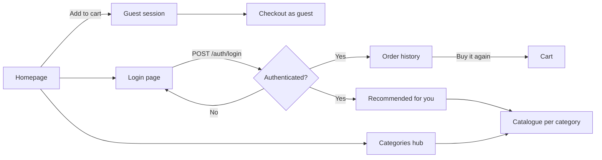
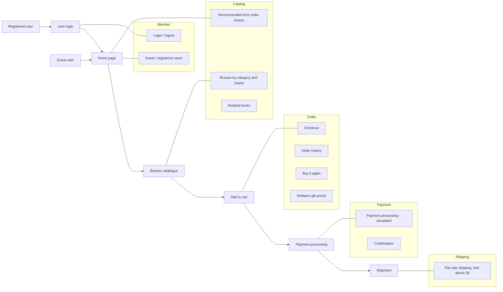

# BookNest — Digital Bookstore Platform

A full-stack e-bookstore with a **React + Vite** frontend and a **NestJS + SQLite/PostgreSQL** backend, featuring a product catalogue, shopping cart, gift-point redemption, and order history.

---

## Project Structure

```
my-book-store/
├── backend/          # NestJS REST API (port 3000)
│   ├── src/
│   │   ├── modules/  # auth, cart, catalogue, checkout, order, recommendation, user
│   │   ├── entities/ # TypeORM entities
│   │   └── database/ # config + auto-seeder
│   └── .env          # local environment (copy from .env.example)
├── frontend/         # React 19 + Vite + Tailwind CSS (port 5173)
│   └── src/
│       ├── components/
│       ├── services/api.ts   # typed fetch wrapper → /api/v1 proxy
│       ├── types/index.ts
│       └── test/             # Vitest unit tests
├── docker-compose.yml        # optional PostgreSQL container
└── package.json              # root convenience scripts
```
---

## Customer Journeys

| # | Journey | Entry point | Frontend | Backend endpoint(s) |

| 0 | **Guest flow** — add books and complete an order without signing in | any page | `ensureSession` in `App.tsx`, `CheckoutView` | `POST /auth/guest`, then `/cart`, `/checkout/process` |
| 1 | Login page | `/login` | `LoginView` | — |
| 2 | User authentication | Login form submit | `api.login`, `api.getCurrentUser` | `POST /auth/login`, `GET /auth/me` |
| 3 | Order history with **Buy It Again**, cancel and return | `/orders` | `OrderHistoryView` | `GET /orders`, `POST /orders/:id/buy-again`, `POST /orders/:id/cancel`, `POST /orders/:id/return` |
| 4 | Recommendations based on order history | Homepage `/` | `api.getOrderHistoryRecommendations` | `GET /recommendations/order-history` |
| 5 | Product catalogue for each category | `/categories` → `/books` | `CategoriesHubView`, `CatalogueView` | `GET /categories`, `GET /books?categorySlug=…` |

### 1. Homepage → Login page

1. An anonymous visitor lands on the homepage (`/`) and can browse the public catalogue.
2. Only **order history** and **recommendations** need a registered account. Cart and checkout are open to guests (see *Guest flow* below). An anonymous visitor opening `/orders` is redirected to `/login`; the Navbar account icon also links there.
3. The login page collects **email** and **password** and shows a generic error ("Invalid email or password") on failure.

### Guest flow (no sign-in required)

1. A visitor browses the catalogue anonymously.
2. On the first **Add to cart**, the frontend calls `POST /api/v1/auth/guest`. The backend creates an anonymous guest account (`isGuest = true`, no password, 0 points, placeholder `@guest.invalid` email) and returns a session token. From then on the cart behaves exactly like a member's cart.
3. At checkout the guest enters a shipping address, a contact **email** and payment details. `POST /checkout/process` completes the order and stores the email on the order (`contactEmail`).
4. Guests cannot redeem gift points and **do not earn** reward points. The confirmation page is shown as usual.
5. A guest account cannot be used to sign in with a password. Guests who later sign in as a registered user start with that user's own cart.

### 2. User authentication

1. The login form calls `POST /api/v1/auth/login` with `{ email, password }`.
2. The backend verifies the password against a salted `scrypt` hash and returns a short-lived signed JWT (`accessToken`) plus the user profile.
3. The frontend stores the token in `sessionStorage` and sends it as `Authorization: Bearer <token>` on every API request.
4. On page load the frontend calls `GET /api/v1/auth/me` to restore the session; an invalid or expired token is discarded.
5. A **Sign out** action clears the token and the cart/user state.
6. All user-scoped endpoints (cart, checkout, orders, addresses, recommendations, profile) derive the user from the token — never from a client-supplied `userId`. Guest sessions use the same mechanism, so a guest can only ever see their own cart and orders.

Demo account (seeded): `alex.johnson@example.com`. Its password is taken from `SEED_USER_PASSWORD` in `backend/.env` (set it before the first start; it is never committed).

### 3. User browses Order History with Buy It Again, Cancel and Return

1. After sign-in the user opens **Orders** (`/orders`) and sees past orders with items, totals and status.
2. Each order has a **Buy it again** button → `POST /api/v1/orders/:id/buy-again`.
3. The backend copies the order's available items into the user's cart; the UI shows a confirmation toast and navigates to `/cart`.
4. A **Cancel order** button is shown while the order is within 48 hours of purchase. Clicking it calls `POST /api/v1/orders/:id/cancel`: the order is set to `CANCELLED`, stock is restored, a `REFUNDED` payment transaction is recorded and gift points are reversed.
5. A **Return order** button is shown from 48 hours up to 30 days after purchase. `POST /api/v1/orders/:id/return` applies the same restock, refund and reversal steps and sets the status to `RETURNED`.
6. The idempotency guard: the transition is committed as a conditional `UPDATE … WHERE status = COMPLETED`. A second request receives a 400 and no double-refund occurs.

### 4. Recommendations based on Order History

1. The backend inspects the signed-in user's previous orders (categories, authors, publishers).
2. `GET /api/v1/recommendations/order-history?limit=4` returns related books the user has not already purchased.
3. These are surfaced to the user as "Recommended for you".

### 5. Access the product catalogue for each category

1. The user opens **Categories** (`/categories`) or picks a category tile on the homepage.
2. Selecting a category navigates to `/books` filtered by that category (`categorySlug`).
3. The catalogue can be sorted, searched and filtered by publisher; selecting a book opens the product detail modal with related books and **Add to cart**.



---

## Architecture of the Online Store

BookNest is organised around five business domains. Registered and guest users both enter through the Home Page; a guest is converted into an anonymous session on the first **Add to cart**.



### Implementation status

| Domain | Capability | Status | Where |
| --- | --- | --- | --- |
| **Member** | Guest and registered users | Implemented | `AuthService`, `POST /auth/guest`, `POST /auth/login` |
| | Login / logout | Implemented (logout clears the client token; there is no server-side revocation) | `api.logout`, `Navbar` |
| | Role and entitlement | Mock — `User.role` is `customer`, `premium` or `admin`; the demo user is `premium` (Crown icon in the Navbar) | `UserRole`, `RolesGuard`, `@Roles()` |
| **Store** | Create stores, catalogues, store policies | Mock — one static store configuration (48 h cancel/modify window, 30 d return, shipping, tax, point value, wallet limits) | `GET /store`, `store.config.ts` |
| **Catalog** | Browse by category and brand | Implemented | `GET /categories`, `GET /brands`, `GET /books` |
| | Recommended products from order history | Implemented | `GET /recommendations/order-history` |
| | Cross-sell | Implemented — related books on the product detail | `GET /books/:id/related` |
| | Up-sell | Implemented — pricier available books from the same category ("You might prefer") | `GET /books/:id/upsell` |
| | Browse by entitlement | Implemented — books flagged `isPremium` are hidden from guests and non-premium users | `Book.isPremium`, `canViewPremium` |
| **Order** | Create order and checkout | Implemented | `POST /checkout/calculate`, `POST /checkout/process` |
| | Order history and Buy it again | Implemented | `GET /orders`, `POST /orders/:id/buy-again` |
| | Redeem gift points | Implemented (registered users only) | `redeemPoints` on checkout |
| | Confirm order | Implemented — orders are created as `COMPLETED` | `CheckoutService` |
| | Cancel order | Implemented — within 48 h of purchase; restocks, refunds and reverses points | `POST /orders/:id/cancel` |
| | Return order | Implemented — between 48 h and 30 days after purchase | `POST /orders/:id/return` |
| | Modify order | Implemented — items can only be reduced or removed, inside the 48 h window; totals, stock, refund and points are recomputed | `PATCH /orders/:id` |
| | Coupons | Implemented — `BOOKNEST10` and `READ2025` (10 %), validated server-side and redeemed atomically | `POST /coupons/validate`, `couponCode` on checkout |
| **Payment** | Payment processing and confirmation | Mock gateway — a card number starting `0000` is declined (no order, no stock change, coupon released); any other payment succeeds | `MockPaymentGateway`, `PaymentTransaction` |
| | Refunds | Simulated `REFUNDED` transaction on cancel/return, including the wallet portion; no real gateway | `PaymentTransaction` |
| | Gift and wallet | Implemented — gift points ledger plus a wallet balance (fixed €25 top-up, max €500) that is spent before the card is charged | `POST /users/wallet/topup`, `useWallet` on checkout |
| **Shipping** | Rate calculation | Implemented — €4.99, free when the discounted subtotal exceeds 35 | `CheckoutService` |
| | Approximate delivery time | Implemented — products show a tentative delivery date | `getTentativeDeliveryDate` |
| | Return shipment | Mock — a `RTN-XXXXXXXX` return label is generated on return, with a print button | `Order.returnLabel` |

---

## Quick Start — Local Development

### Prerequisites

- **Node.js** ≥ 20 (check with `node -v`)
- **npm** ≥ 10

No database setup is required for SQLite mode (the default).

---

### 1 — Install all dependencies

```bash
npm run install:all
```

Or install each workspace individually:

```bash
npm install --prefix backend
npm install --prefix frontend
```

---

### 2 — Configure the backend environment

```bash
cp backend/.env.example backend/.env
```

The default `.env` uses **SQLite** with a local file `backend/ebookstore.sqlite`.

Authentication requires two values in `backend/.env` (the backend refuses to start without a strong `JWT_SECRET`):

```dotenv
# Generate with: openssl rand -hex 48  (minimum 32 characters)
JWT_SECRET=<random value>
JWT_EXPIRES_IN_SECONDS=3600
# Password assigned to the seeded demo user (local development only)
SEED_USER_PASSWORD=<choose a password>
```

`backend/.env` is git-ignored — never commit real secrets.

To switch to **PostgreSQL**, edit `backend/.env`:

```dotenv
DATABASE_TYPE=postgres
DB_HOST=127.0.0.1
DB_PORT=5432
DB_USERNAME=postgres
DB_PASSWORD=postgres
DB_NAME=ebookstore
```

Then start a PostgreSQL instance:

```bash
docker compose up -d   # uses docker-compose.yml
```

---

### 3 — Start the backend

```bash
npm run start:backend
# → http://127.0.0.1:3000/api/v1
# → Swagger UI: http://127.0.0.1:3000/docs
```

On first start the backend **auto-seeds** the database with:
- 6 categories, 8 publishers/brands, 20 books
- Demo user **Alex Johnson** (`alex.johnson@example.com`) with 500 gift points (password from `SEED_USER_PASSWORD`)
- Two saved delivery addresses and one completed past order

---

### 4 — Start the frontend

Open a second terminal:

```bash
npm run start:frontend
# → http://127.0.0.1:5173
```

Vite proxies all `/api/v1/*` requests to `http://127.0.0.1:3000`, so the frontend and backend communicate without CORS issues during development.

---

## Frontend ↔ Backend Integration

| Frontend call | Vite proxy target | NestJS route |
|---|---|---|
| `POST /api/v1/auth/login` | `http://127.0.0.1:3000` | `AuthController` |
| `POST /api/v1/auth/guest` | `http://127.0.0.1:3000` | `AuthController` |
| `GET /api/v1/auth/me` | `http://127.0.0.1:3000` | `AuthController` |
| `GET /api/v1/books` | `http://127.0.0.1:3000` | `CatalogueController` |
| `GET /api/v1/categories` | `http://127.0.0.1:3000` | `CatalogueController` |
| `POST /api/v1/cart` | `http://127.0.0.1:3000` | `CartController` |
| `POST /api/v1/checkout/process` | `http://127.0.0.1:3000` | `CheckoutController` |
| `GET /api/v1/orders` | `http://127.0.0.1:3000` | `OrderController` |
| `GET /api/v1/recommendations/order-history` | `http://127.0.0.1:3000` | `RecommendationController` |
| `GET /api/v1/users/profile` | `http://127.0.0.1:3000` | `UserController` |

The proxy is configured in [`frontend/vite.config.ts`](frontend/vite.config.ts).  
The typed API client is at [`frontend/src/services/api.ts`](frontend/src/services/api.ts).

---

## Available Scripts

From the **root** directory:

| Script | Description |
|---|---|
| `npm run install:all` | Install backend + frontend dependencies |
| `npm run start:backend` | Start NestJS backend (ts-node, hot reload) |
| `npm run start:frontend` | Start Vite dev server |
| `npm run build:all` | TypeScript compile + Vite production build |
| `npm run test:all` | Run backend Jest + frontend Vitest suites |
| `npm run test:cov` | Run both test suites with coverage reports |
| `npm run lint:all` | `tsc --noEmit` on both workspaces |

---

## Running Tests

```bash
# Backend (Jest)
npm test --prefix backend          # 65 tests across 9 specs

# Frontend (Vitest)
npm test --prefix frontend         # 98 tests across 20 test files

# Both at once
npm run test:all
```

---

## API Documentation (Swagger)

Once the backend is running, interactive OpenAPI docs are available at:

```
http://127.0.0.1:3000/docs
```

User-scoped endpoints require `Authorization: Bearer <accessToken>` (obtain it from `POST /auth/login`). The catalogue endpoints (`/categories`, `/brands`, `/books`) are public.

---

## Authentication & Security

- Passwords are hashed with **scrypt** (random 16-byte salt, constant-time comparison) and are never returned by the API.
- Access tokens are **HS256 JWTs** with a short lifetime (`JWT_EXPIRES_IN_SECONDS`, default 1 hour); other algorithms, `alg=none`, expired and tampered tokens are rejected.
- `POST /auth/login` is rate-limited (5 attempts per minute per client) and returns the same generic error for unknown emails and wrong passwords. `POST /auth/guest` is rate-limited too (10 per minute).
- Guest accounts have no password and an unroutable `@guest.invalid` email, so they cannot be signed into; they hold a cart and orders only.
- Cart, checkout, orders, addresses, recommendations and profile derive the user from the verified token; the former `userId` query parameter has been removed.
- The frontend keeps the token in `sessionStorage` (cleared on sign out and when the tab closes).

---

## Tech Stack

| Layer | Technology |
|---|---|
| Frontend | React 19, TypeScript, Vite 6, Tailwind CSS 3, Lucide React |
| Backend | NestJS 11, TypeORM 0.3, SQLite (dev) / PostgreSQL 16 (prod) |
| Testing | Vitest 3 + React Testing Library (frontend), Jest 29 (backend) |
| API Spec | OpenAPI 3.0 via `@nestjs/swagger` |
